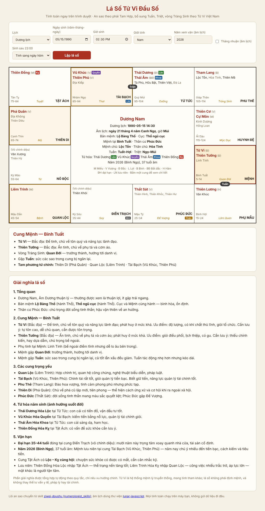

# Lá Số Tử Vi

Ứng dụng xem lá số Tử Vi Đẩu Số chạy **hoàn toàn trên trình duyệt**: không cần Python, không cần máy chủ, dữ liệu không rời khỏi máy người dùng.



## Tính năng
- Lập lá số từ ngày giờ sinh dương lịch hoặc âm lịch (hỗ trợ tháng nhuận, giờ Tý sau 23:00).
- Bàn 12 cung bố cục truyền thống: 14 chính tinh kèm độ sáng, phụ tinh, lục sát, Tứ hóa, cung Thân, Cục, Mệnh chủ – Thân chủ, tuổi đại hạn.
- Bổ sung theo Tử Vi Việt Nam: **Tuần**, **Triệt** (đặt trên ranh giới hai cung), **vòng Tràng Sinh**, nạp âm bản mệnh, sinh khắc Cục – Mệnh, Âm Dương thuận/nghịch lý.
- Bấm vào cung để xem tam phương tứ chính.
- Mục **Giải nghĩa lá số**: tổng quan, cung Mệnh, các cung trọng yếu, Tứ hóa năm sinh, đại hạn và lưu niên (song Lộc, song Kỵ, Lộc – Kỵ cùng hội).

## Sử dụng
- Mở trực tiếp `index.html` bằng trình duyệt, hoặc
- Bật GitHub Pages: *Settings → Pages → Deploy from a branch → `main` / root*.

## Cấu trúc
| File | Vai trò |
|---|---|
| `js/engine.js` | Lõi an sao. Phần Tam Hợp chuyển 1:1 từ `ziwei-doushu/scripts/ziwei_cli.py` của [numerologist_skills](https://github.com/fanzr-arch/numerologist_skills); phần Việt Nam (Tuần, Triệt, Tràng Sinh, nạp âm) viết bổ sung |
| `js/interpret.js` | Từ điển Hán – Việt và phần giải nghĩa (dịch, biên tập từ `references/stars.md`, `references/sihua.md` của skill) |
| `js/app.js`, `css/style.css`, `index.html` | Giao diện |
| `js/lunar.js` | Thư viện âm lịch [lunar-javascript](https://github.com/6tail/lunar-javascript) 1.7.7 (MIT) |
| `tests/` | Kiểm thử đối chiếu với script Python gốc |

## Kiểm chứng
```bash
npm test
```
So khớp lõi JavaScript với kết quả của script Python gốc (100 ca trong `tests/fixtures.json`) và kiểm tra quy tắc Tuần, Triệt, nạp âm, Tràng Sinh. Khi phát triển đã đối chiếu thêm 5.000 ca ngẫu nhiên (1901–2099), khớp 100%. Có thể tự sinh lại dữ liệu đối chiếu:
```bash
python tests/gen_fixtures.py <đường_dẫn>/numerologist_skills/ziwei-doushu/scripts 5000 /tmp/big.json && node tests/run.js /tmp/big.json
```

## Quy ước tính
- An sao chính theo phái Tam Hợp (theo skill gốc); độ sáng sao theo bảng tổng của *Tử Vi Đẩu Số Toàn Thư*. Một số phần mềm Tử Vi Việt Nam dùng bảng độ sáng, cách an Hỏa – Linh hoặc Tứ hóa khác ở vài trường hợp.
- Năm đổi theo mùng 1 Tết; tuổi đại hạn tính theo tuổi âm (tuổi mụ).
- Tháng nhuận: mặc định ngày 1–15 tính theo tháng hiện tại, từ ngày 16 tính sang tháng sau.
- Tuần: theo tuần Giáp chứa can chi năm sinh. Triệt: Giáp Kỷ – Thân Dậu, Ất Canh – Ngọ Mùi, Bính Tân – Thìn Tỵ, Đinh Nhâm – Dần Mão, Mậu Quý – Tý Sửu.
- Tràng Sinh: Thủy, Thổ cục khởi tại Thân; Mộc tại Hợi; Kim tại Tỵ; Hỏa tại Dần. Dương Nam, Âm Nữ đi thuận; Âm Nam, Dương Nữ đi nghịch.
- Chưa an: Cô Thần, Quả Tú, vòng Thái Tuế, vòng Lộc Tồn (Bác Sĩ…) và các tiểu tinh khác.

## Lưu ý
Tử Vi là hệ thống mệnh lý truyền thống; nội dung chỉ mang tính tham khảo, không thay thế tư vấn y tế, pháp lý hay tài chính.
